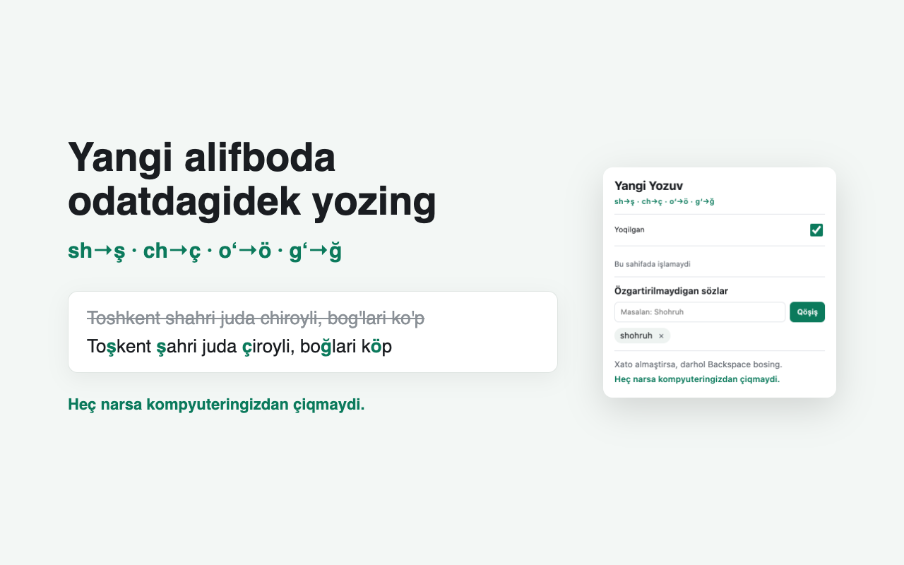

# Yangi Yozuv

**Yangi oʻzbek alifbosida odatdagidek yozing.** A browser extension that
converts Uzbek words to the new Latin alphabet as you type:

| You type | You get |
|---|---|
| `sh` | `ş` |
| `ch` | `ç` |
| `oʻ` / `o'` | `ö` |
| `gʻ` / `g'` | `ğ` |

`shahar choy oʻzbek togʻ` → `şahar çoy özbek toğ`

The new alphabet (Law O'RQ-1184) takes effect on **22 April 2027**. The new
letters aren't on Uzbek keyboards, so this lets people keep typing the way they
already do.



## How it behaves

- A word converts when you finish it with a space, punctuation or Enter. Enter
  is handled on its own because chat apps send the message on Enter.
- **English words, links, domains, emails, @handles, #hashtags and brand names
  like ChatGPT are left alone.** When unsure, it doesn't convert: a missed
  conversion is a small annoyance, a broken link is not.
- **One Backspace right after a conversion restores what you typed.**
- A list of words you never want converted (names, brands) lives in the popup.
- Works out of the box on `.uz` sites, Telegram Web, Gmail, WhatsApp Web,
  Facebook, Instagram, X, LinkedIn, YouTube, Outlook, ChatGPT, Gemini and
  Claude. On any other site, open the popup and turn it on for that site only.
- Google Docs isn't supported yet.

## Privacy

Nothing you type leaves your computer. The extension makes no network requests,
has no analytics and needs no account. Settings stay in your browser. See
[PRIVACY.md](PRIVACY.md), and check the code: it's all in this repo.

## Install

Chrome Web Store: _coming soon._

To try it now from source (Chrome, Edge, Opera, Yandex Browser):

```bash
git clone https://github.com/azamt18/yangi-yozuv.git
cd yangi-yozuv
npm install
npm run build
```

Then open `chrome://extensions`, turn on **Developer mode**, click **Load
unpacked** and choose the `.output/chrome-mv3` folder. On macOS the file picker
hides folders starting with a dot; press **Cmd+Shift+.** to show it.

## Development

```bash
npm test            # unit tests for the converter and typing logic
npm run test:e2e    # builds, then types into real fields in Chrome for Testing
npm run compile     # type check
npm run dev         # opens Chrome with the extension loaded, reloads on save
```

| Path | What it is |
|---|---|
| `src/core/` | Converter and typing logic. No browser code, so it can be ported to Kotlin and Swift using the same test cases. |
| `src/core/data/english-words.json` | English words never to convert. Generated by `npm run build:words` from [SCOWL](http://wordlist.aspell.net/) via `wordlist-english` (MIT). |
| `src/entrypoints/content.ts` | Watches typing in text fields and applies conversions. |
| `src/entrypoints/background.ts` | Starts the extension on sites the user adds. |
| `src/entrypoints/popup/` | Settings popup. |
| `store/` | Chrome Web Store listing text and graphics. |

Built with [WXT](https://wxt.dev), TypeScript and Vitest. Publishing notes are
in [docs/PUBLISHING.md](docs/PUBLISHING.md).

## Contributing

Bug reports are very welcome, especially "this site breaks" reports. Include the
site, what you typed, what you expected and what happened. Words that convert
wrongly (or should be left alone) are fixed by adding a test case in
`src/core/convert.test.ts`.

## License

[MIT](LICENSE)
